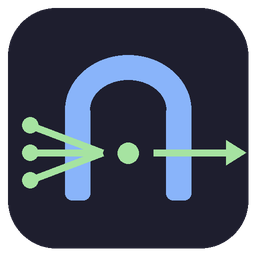
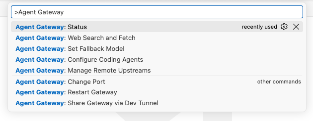

# Agent Gateway

### Your Copilot models. Your favorite coding agents.

Bring the models available in GitHub Copilot to **Claude Code, Codex, Gemini CLI** and more—through one gateway inside VS Code.

**[Website](https://ness001.github.io/agent-gateway/)** · **[Install for VS Code](https://marketplace.visualstudio.com/items?itemName=ness001.agent-gateway)** · **[Get started](#getting-started)** · **[Supported agents](#supported-agents)** · **[Reference](docs/reference.md)**

---

## Keep your agent. Choose your model.

Use the workflow you like without being tied to its default model provider.
Agent Gateway connects your coding agents to the models available in your
Copilot account. It handles API translation, agent configuration, model routing
and optional web search.

**Claude Code · Codex · Gemini CLI · Antigravity CLI · Oh My Pi · Pi · Hermes · OpenClaw · Kilo Code · Cline · DeepSeek Harness · Cursor**

Setup varies by agent; see [supported agents](#supported-agents) for automatic
configuration, manual steps and live-testing limitations.

### One gateway, more possibilities

|                                | What you get                                                                                                                |
| ------------------------------ | --------------------------------------------------------------------------------------------------------------------------- |
| **🔌 Keep your tools**         | Your agent's shell commands, file edits and MCP tools stay with your agent.                                                 |
| **⚡ Set up from VS Code**     | Choose agents and a model, review the settings changes, then confirm. Backups and undo are built in.                        |
| **🔀 Speak the right API**     | Anthropic Messages, OpenAI Responses and Chat Completions, and Gemini APIs—including streaming and tool-call translation.   |
| **🌍 Connect your machines**   | Share through a dev tunnel or add remote gateways. Choose a local or remote model as an explicit fallback.                  |
| **🔎 Search and read the web** | Enable web search and URL fetch through Exa, Firecrawl, Tavily, Jina AI or You.com. Several engines offer anonymous access. |
| **🔍 See what's happening**    | Inspect models, remotes and recent errors in **Status**. Follow request IDs without logging prompts or keys.                |

> **Runs inside VS Code.** No separate gateway server to deploy. You need
> GitHub Copilot Chat, signed in, and permission to access its language models.
> Available models and usage limits depend on your account. The gateway runs
> while VS Code is open; it does not bypass provider quotas.

## Getting started

1. [Install Agent Gateway](https://marketplace.visualstudio.com/items?itemName=ness001.agent-gateway).
   You need VS Code with GitHub Copilot Chat, signed in.
2. When VS Code asks whether Agent Gateway may use the Copilot language
   models, choose **Allow**. Without this, no models are served.
3. Click **Gateway** in the status bar (or run **Agent Gateway: Status**) and
   check that it says **Ready**.
4. Run **Agent Gateway: Configure Coding Agents**, pick your agents and a
   default model, review the changes and confirm.

Follow any remaining setup or restart instructions shown for your agents.
The default local endpoint is `http://127.0.0.1:24444`. Open **Status** >
**API URLs** to copy endpoints using your configured port, including token-count URLs.

Need a different setup? [Connect an agent manually](docs/reference.md#manual-client-setup),
[share models between machines](#share-models-between-machines), or
[enable web search](#web-search-and-url-fetch).

To turn the gateway off without uninstalling, set `agentGateway.enabled` to `false`.

### Find the commands

Open the Command Palette (**⇧⌘P** on macOS, **Ctrl+Shift+P** on Windows/Linux)
and type **Agent Gateway**.

## Explore

[Supported agents](#supported-agents) · [Model routing](#model-mappings-and-fallback) · [Commands](#commands) · [Remote models](#share-models-between-machines) · [Web search](#web-search-and-url-fetch) · [Settings](#settings) · [Troubleshooting](#troubleshooting) · [Privacy](#privacy-and-security)

## Supported agents

| Agent                    | How it is configured                                                                                                                            |
| ------------------------ | ----------------------------------------------------------------------------------------------------------------------------------------------- |
| Claude Code              | Configures the gateway and automatic model discovery.                                                                                           |
| Codex                    | Adds an `agent-gateway` provider and makes it the default.                                                                                      |
| Gemini CLI               | Configures the endpoint, key, model and authentication. Restart the CLI; shell or project overrides may take precedence. Not yet verified live. |
| Antigravity CLI (`agy`)  | Configures Gemini mode and provides remaining setup steps. Requires a compatible model or mapping.                                              |
| Oh My Pi (omp)           | Adds the gateway as a provider with automatic model discovery; pick a model with `/model`.                                                      |
| Pi                       | Adds the gateway with its model list; run **Configure Coding Agents** again after models change.                                                |
| Hermes Agent             | Adds an `agent-gateway` provider; run `hermes --provider agent-gateway` or pick it in `hermes model`.                                           |
| OpenClaw                 | Adds the gateway with its model list. Checked against OpenClaw's documentation, not yet tested with a live install.                             |
| Kilo Code                | Adds the gateway with its model list; pick `agent-gateway/<model>` with `/models`.                                                              |
| Cline (CLI)              | Adds an OpenAI Compatible provider and makes it active; switch models with `cline -m <model>`. The Cline VS Code extension is set up by hand.   |
| DeepSeek Harness (`dsh`) | Adds the gateway with its model list and makes your chosen model the default; removing it restores the previous default.                        |
| Cursor                   | Shows manual steps. Cursor calls models from its own servers, so it needs a shared (dev tunnel) URL.                                            |
| Any other agent          | Use the OpenAI, Anthropic or Gemini base URL; see [manual setup](docs/reference.md#manual-client-setup).                                        |

Each changed file is backed up next to itself as
`<file>.agent-gateway-<timestamp>.bak`. **Configure Coding Agents** >
**Remove gateway** reverts only what the gateway added.

## Commands

All commands are under **Agent Gateway** in the Command Palette.

| Command                      | What it does                                                                     |
| ---------------------------- | -------------------------------------------------------------------------------- |
| Status                       | Shows state, models, remotes, errors and copyable API URLs, with quick actions.  |
| Restart Gateway              | Restarts the local gateway.                                                      |
| Change Port                  | Moves the gateway to another port and offers to update your agents.              |
| Set Fallback Model           | Manages model mappings, AI suggestions and an optional local or remote fallback. |
| Configure Coding Agents      | Sets up, updates or removes the gateway in your agents.                          |
| Web Search and Fetch         | Chooses the web search engine and its API key.                                   |
| Share Gateway via Dev Tunnel | Shares your gateway with another machine and manages the gateway API key.        |
| Manage Remote Upstreams      | Adds, tests or removes another machine's gateway.                                |

## Share models between machines

On the machine with Copilot, run **Share Gateway via Dev Tunnel**. It installs
and signs in to the `devtunnel` CLI if needed, offers to create a gateway API
key, and starts a tunnel whose URL stays the same across runs. Hosting runs in
an extension-managed background process, not an integrated terminal. Use **Copy
client setup** to send the URL (the key is never included).

The gateway checks the public connection automatically. **Status** shows
**Connecting**, then **Connected** with the discovered model count, or the
connection-check failure. You can start, manage or stop sharing from **Status**.

Run **Share Gateway via Dev Tunnel** again and choose **Stop sharing** to stop
hosting. Hosting also stops when the extension shuts down. Installation and
sign-in may still open a terminal for interactive steps.

On the other machine, run **Manage Remote Upstreams** > **Add remote
upstream**, paste the URL and enter the key. Its models appear as
`<name>--<model>`.

> Anyone with the tunnel URL and key can use your Copilot models. Always set a
> gateway API key before sharing.

## Web search and URL fetch

Web search is off until you turn it on. Run **Web Search and Fetch**, pick an
engine, and enter its API key, or leave the key empty to use the engine's
free anonymous endpoint where there is one.

| Engine    | Without a key                   |
| --------- | ------------------------------- |
| Exa       | Search and fetch (rate-limited) |
| Firecrawl | Search and fetch (rate-limited) |
| Jina AI   | Fetch only                      |
| Tavily    | Needs a key                     |
| You.com   | Needs a key                     |

Keys are stored in VS Code secret storage, never in `settings.json`. For Codex,
the command also offers to turn on its live search (`web_search = "live"`).
Search queries, results and page text are never logged.

## Settings

| Setting                                        | Default             | Description                                                         |
| ---------------------------------------------- | ------------------- | ------------------------------------------------------------------- |
| `agentGateway.enabled`                         | `true`              | Run the gateway.                                                    |
| `agentGateway.port`                            | `24444`             | Local port. Use **Change Port** to change it safely.                |
| `agentGateway.logLevel`                        | `info`              | `error`, `warn`, `info` or `debug`.                                 |
| `agentGateway.remoteUpstreams`                 | `[]`                | Other machines' gateways (managed by **Manage Remote Upstreams**).  |
| `agentGateway.webSearch.provider`              | `none`              | Web search engine (managed by **Web Search and Fetch**).            |
| `agentGateway.webSearch.maxSearchesPerRequest` | `5`                 | Most searches per request (1-20).                                   |
| `agentGateway.webSearch.model`                 | `""`                | Model for Gemini CLI search requests when its model is unknown.     |
| `agentGateway.modelMappings`                   | Two empty mappings¹ | Map requested names to local models through **Set Fallback Model**. |
| `agentGateway.fallbackModel`                   | `""`                | Model for unknown model names (managed by **Set Fallback Model**).  |

¹ The default mapping keys are `claude-haiku-5.5` and `claude-sonnet-5`, both
empty. They do not force a replacement model.

## Model mappings and fallback

**Model selection** chooses the model your agent requests. **Model mappings**
route a requested name to another model through `agentGateway.modelMappings`.

Choose your main model in **Configure Coding Agents**. For sub-agents and
background tasks that request a different model name, use **Set Fallback Model**
to manage routing in the gateway—no manual agent configuration is needed for
these mappings.

- **Map a specific name:** choose a **Mapping** entry and select its target.
- **Get suggestions:** choose **Initialize model mappings with AI…**, review
  the suggestions and save only the mappings you want.
- **Handle unknown names:** select a local or remote fallback model, or
  **No fallback** to disable it. No fallback is selected automatically.

Existing-model errors do not trigger fallback. Gemini unknown names use model mappings,
not the general fallback rule. See [model routing details](docs/reference.md#unknown-models-and-aliases).

### AI-assisted model mappings

Choose **Set Fallback Model** > **Initialize model mappings with AI…**. Enter the
requested model names, choose an advisor model, then review and select suggestions
to save. Existing mappings stay unchanged unless you select replacements.
Canceling saves nothing; saved mappings apply without restarting the gateway.

The advisor receives model names and metadata—not files or conversations—and
uses Copilot quota. Suggestions target compatible local models, not remote models;
they are recommendations, not benchmark rankings.

See [mapping details](docs/reference.md#unknown-models-and-aliases) for defaults,
matching rules and configuration precedence.

## Server tools

Your agent's own tools (commands, file edits, MCP servers) run on your
machine and work unchanged.

Some tools normally run on the model provider's servers. Copilot models in VS
Code have no such servers, so the gateway runs what it can itself:

| Server tool                                                                                             | Through the gateway                                                                                       |
| ------------------------------------------------------------------------------------------------------- | --------------------------------------------------------------------------------------------------------- |
| Web search (Anthropic `web_search`, OpenAI `web_search`, Gemini `googleSearch`)                         | Run by the gateway through the engine you pick in **Web Search and Fetch**. Off until you pick one.       |
| Gemini URL context (`urlContext`, Gemini CLI's `web_fetch`)                                             | Run by the gateway, unless the same request also has the agent's own tools.                               |
| Anthropic `web_fetch`                                                                                   | Run by the gateway with the same engine. Only pages whose URL is already in the conversation are fetched. |
| Code execution (Anthropic `code_execution`, OpenAI code interpreter, Gemini `codeExecution`)            | Not supported. Left out (Anthropic: the request fails).                                                   |
| OpenAI `file_search`, image generation, remote `mcp`, hosted `tool_search`; Gemini Maps and File Search | Not supported. Left out.                                                                                  |
| Other Anthropic server tools (MCP connector, tool search, advisor)                                      | Not supported. The request fails.                                                                         |

A tool that is left out is never shown to the model, and the **Agent Gateway**
output panel notes it. Support depends on the tool requested, not just the agent.

## Troubleshooting

- **Status shows Waiting for Copilot:** make sure Copilot Chat is signed in and
  that you allowed Agent Gateway to use the language models.
- **Port in use:** another program has port 24444. The gateway keeps retrying;
  use **Change Port** to pick another one.
- **A request failed:** every response has a `request-id` (and
  `x-request-id`) header. Find that
  ID in **Status** > **Open error log** or in the **Agent Gateway** output
  panel. Set `agentGateway.logLevel` to `debug` for more detail.
- **An agent stopped working after changing the port:** run **Configure Coding
  Agents** again.

### Known issues

- **Codex browser tools need separate authentication:** model requests can work
  through the gateway while browser tools require a Codex sign-in. The gateway
  does not provide that token. See [Codex authentication](https://developers.openai.com/codex/auth).
- **Antigravity CLI fails with "invalid stream chunk: : ping":** during a long
  pause the gateway sends a standard keep-alive line on the stream, and
  Antigravity CLI 1.4.3 does not accept it. Other agents are not affected.
  Retry the request.
- **Claude Code auto-mode eligibility notice:** run **Configure Coding Agents**
  again to apply the gateway-compatible setting. Checks may use Copilot quota
  rather than the no-charge classifier path.

## Privacy and security

- The gateway listens on your computer only (loopback). Nothing is reachable
  from other machines unless you share it through a dev tunnel.
- Prompts, request bodies, tool arguments, search queries and API keys are
  never logged.
- Gateway and search-service keys are managed in VS Code secret storage.
  Configuring an agent may also write the gateway key into its settings or
  environment file. Treat these files and their backups as sensitive.

## More information

- [Reference](docs/reference.md): API endpoints, manual client setup, how web
  search and model fallback work, logs.
- [Contributing](CONTRIBUTING.md): building, testing and the project's design.
- [Changelog](CHANGELOG.md).

## Star history

## License

[MIT](LICENSE)
